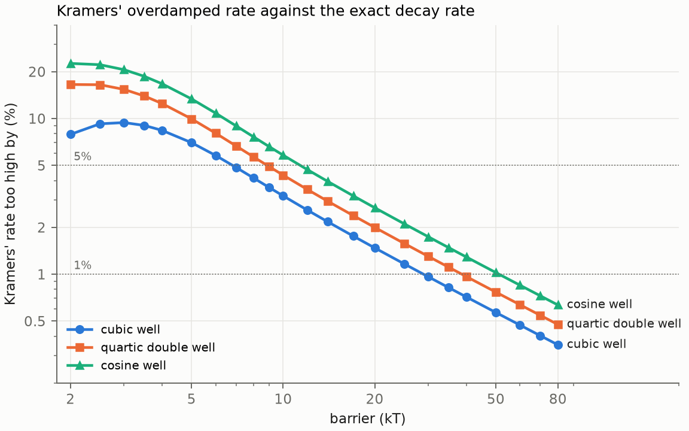

# M01. Kramers' overdamped rate on three wells

!!! note "Status"
    Draft: the claim below has not yet been approved by the maintainer.

**Claim (computed 2026-11-24, kramers 0.1.0).** Kramers' overdamped rate is too high at every barrier from 2 to 80 kT on all three wells. At 10 kT it is 3.2%, 4.3% and 5.8% high (cubic well, quartic double well, cosine well). It is within 5% above 6.8, 8.9 and 11.4 kT, and within 1% above 29, 38.8 and 51.4 kT (each threshold placed between two grid barriers by interpolation).



## What is compared

- **Approximation:** Kramers' overdamped escape rate (K0001).
- **Exact side:** the exact decay rate of the survival probability (the smallest eigenvalue of the backward operator), from the quadrature solver; set-ups as in K0001's own checks.
- **Stored values:** Kramers' rate / exact decay rate - 1, at each barrier (kT).
- **Entries:** [K0001](../handbook/K0001.md).

## Notes

Barriers below 2 kT, and the comparison with the reciprocal mean passage time (which differs from the decay rate at low barriers), are left out of this map for now. Cosine well: escape over either of two barriers, so twice the one-sided Kramers rate.

## Earlier work

- A. Edholm and O. Leimar, The accuracy of Kramers' theory of chemical kinetics, Physica A 98, 313 (1979). [doi:10.1016/0378-4371(79)90182-1](https://doi.org/10.1016/0378-4371(79)90182-1) Read: not opened (title and bibliographic record checked on Crossref).
- J. J. Mazo, O. Y. Fajardo and D. Zueco, Thermal activation at moderate-to-high and high damping: finite barrier effects and force spectroscopy, J. Chem. Phys. 138, 104105 (2013). [doi:10.1063/1.4793983](https://doi.org/10.1063/1.4793983) Read: not opened (bibliographic record checked on Crossref).

## Data and how to reproduce it

```python
from kramers import atlas
m = atlas.get("M01")
data = m.load()   # axes, series (None where not mapped), facts
print(m.claim())
```

Recompute: `python tools/build_atlas.py M01` (writes `src/kramers/data/atlas_M01.json` and this figure).

## How it is checked

| Check | Against | Latest result |
|---|---|---|
| the claim follows from the stored data | the stored grid | pass: worst 0.0e+00 (tolerance 0e+00), 2026-11-24 |
| the stored map is current (slow, nightly) | the same computation, at sample points | pass: worst 0.0e+00 (tolerance 1e-06), 2026-11-24 |
