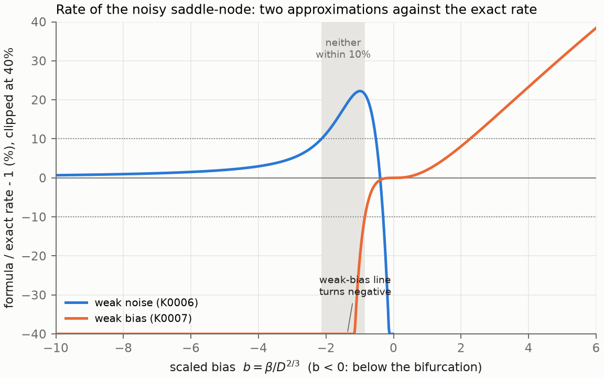

# M02. Firing rate of the noisy saddle-node: weak-noise and weak-bias formulas

!!! note "Status"
    Draft: the claim below has not yet been approved by the maintainer.

**Claim (computed 2026-11-24, kramers 0.1.0).** For dx/dt = beta + x^2 + sqrt(2D) xi both formulas depend only on b = beta/D^(2/3). The weak-noise rate is within 10% of the exact rate for b <= -2.14 (a barrier of 4.2 noise units, 4|b|^(3/2)/3), within 5% for b <= -3.02 and within 1% for b <= -7.8 (barrier 29). Closer to the bifurcation it is up to 22.2% too high (at b = -1), then crosses zero near b = -0.4 on its way to -100% at b = 0, so it is within 10% again, in passing, for -0.52 <= b <= -0.32. The weak-bias line is within 10% for -0.84 <= b <= 2.26, within 1% for -0.46 <= b <= 0.72, and gives a negative rate below b = -1.37. So for -2.14 < b < -0.84 neither formula is within 10% at any grid point (within 5%: -3.02 < b < -0.7).



## What is compared

- **Approximation:** the weak-noise rate (K0006) and the rate to first order in the bias (K0007).
- **Exact side:** the exact rate 1/T, T the mean passage time from minus to plus infinity, in Airy functions (K0004); the sources define the rate this way, as a firing rate.
- **Stored values:** formula / exact rate - 1, against the scaled bias b = beta / D^(2/3).
- **Entries:** [K0006](../handbook/K0006.md), [K0007](../handbook/K0007.md).

## Notes

All three rates are in closed form, so the map is exact up to rounding. b > 0 is above the bifurcation (no barrier), where the weak-noise formula does not apply.

## Earlier work

- B. Lindner, A. Longtin and A. Bulsara, Analytic expressions for rate and CV of a type I neuron driven by white Gaussian noise, Neural Comput. 15, 1761 (2003). [doi:10.1162/08997660360675035](https://doi.org/10.1162/08997660360675035) Read: author's PDF, read 12 Oct 2026 for Eqs. (3.10)-(3.11); whether it plots this comparison was not checked.

## Data and how to reproduce it

```python
from kramers import atlas
m = atlas.get("M02")
data = m.load()   # axes, series (None where not mapped), facts
print(m.claim())
```

Recompute: `python tools/build_atlas.py M02` (writes `src/kramers/data/atlas_M02.json` and this figure).

## How it is checked

| Check | Against | Latest result |
|---|---|---|
| the claim follows from the stored data | the stored grid | pass: worst 0.0e+00 (tolerance 0e+00), 2026-11-24 |
| the stored map is current (slow, nightly) | the same computation, at sample points | pass: worst 0.0e+00 (tolerance 1e-06), 2026-11-24 |
