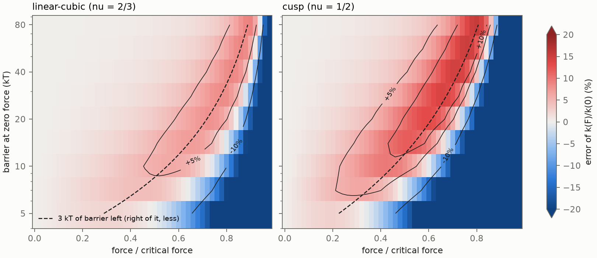

# M03. Force-dependent rate of Dudko, Hummer and Szabo

!!! note "Status"
    Draft: the claim below has not yet been approved by the maintainer.

**Claim (computed 2026-11-24, kramers 0.1.0).** Where at least 3 kT of barrier is left at the applied force (the formula warns below that), the largest error on the grid in the force dependence of the rate is +8.8% for the linear-cubic surface (at 3.3 kT left, dG = 80 kT) and +15.6% for the cusp (at 3.2 kT left, dG = 80 kT). Every grid point is within 10% where more than 1 kT (linear-cubic) or 5.8 kT (cusp) of barrier is left, and within 5% above 6.1 kT and 10.4 kT.



## What is compared

- **Approximation:** the force dependence k(F)/k(0) of the Dudko-Hummer-Szabo rate (K0026), with k(0) the exact zero-force rate, as when k0 is fitted.
- **Exact side:** the exact decay rate at each force, from the quadrature solver, for the landscapes the formula is derived for: the tilted linear-cubic surface (nu = 2/3) and a harmonic well cut off by a cusp, absorbing there (nu = 1/2).
- **Stored values:** [k_DHS(F)/k_DHS(0)] / [lambda(F)/lambda(0)] - 1, over the zero-force barrier dG (kT) and F as a fraction of the critical force dG/(nu x).
- **Entries:** [K0026](../handbook/K0026.md).

## Notes

The error is zero at zero force by construction (k0 is the exact zero-force rate). For nu = 2/3 the formula is Kramers' rate for the tilted surface (K0026's first check), so this map is the cubic curve of M01 seen through the force: the error depends on the barrier left at F and at zero force only. kT = D = x = 1 throughout; the map is in scaled units.

## Earlier work

- O. K. Dudko, G. Hummer and A. Szabo, Intrinsic rates and activation free energies from single-molecule pulling experiments, Phys. Rev. Lett. 96, 108101 (2006). [doi:10.1103/PhysRevLett.96.108101](https://doi.org/10.1103/PhysRevLett.96.108101) Read: published PDF (Zenodo record 1233953), read 14 Oct 2026 for Eqs. (1)-(6); its comparisons with simulation were not reviewed for this map.
- J. J. Mazo, O. Y. Fajardo and D. Zueco, Thermal activation at moderate-to-high and high damping: finite barrier effects and force spectroscopy, J. Chem. Phys. 138, 104105 (2013). [doi:10.1063/1.4793983](https://doi.org/10.1063/1.4793983) Read: not opened; the closest earlier work by its title, to read before any claim of novelty.

## Data and how to reproduce it

```python
from kramers import atlas
m = atlas.get("M03")
data = m.load()   # axes, series (None where not mapped), facts
print(m.claim())
```

Recompute: `python tools/build_atlas.py M03` (writes `src/kramers/data/atlas_M03.json` and this figure).

## How it is checked

| Check | Against | Latest result |
|---|---|---|
| the claim follows from the stored data | the stored grid | pass: worst 0.0e+00 (tolerance 0e+00), 2026-11-24 |
| the stored map is current (slow, nightly) | the same computation, at sample points | pass: worst 0.0e+00 (tolerance 1e-06), 2026-11-24 |
