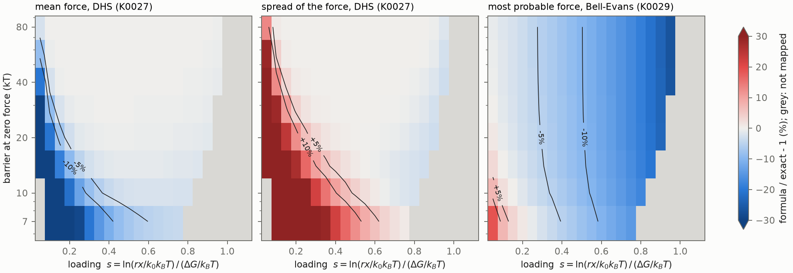

# M04. Rupture force under constant loading: Dudko-Hummer-Szabo and Bell-Evans

!!! note "Status"
    Draft: the claim below has not yet been approved by the maintainer.

**Claim (computed 2026-11-24, kramers 0.1.0).** On the linear-cubic surface the Bell-Evans most probable force is too low wherever s >= 0.25: by 8% to 10% at s = 0.5 across the barriers mapped, and by up to 27% at the fastest loading mapped. At the slowest loading on low barriers it is too high instead, by up to 19%. At large barriers its error approaches s / [1.5 (1 - (1 - s)^(2/3))] - 1, Bell's force s dG / x divided by the force at which this surface's barrier has fallen to (1 - s) dG (leading order); for s >= 0.2 the 80 kT row follows that curve to within 0.045 percentage points and the 20 kT row to within 0.49. The Dudko-Hummer-Szabo mean force is within 5% of the exact mean once ln(r x / (k0 kT)) exceeds 3.3 to 4.2, depending on the barrier (7 to 80 kT), and its spread once it exceeds 4.3 to 5.4 (thresholds refined between grid points by root finding). At slower loading both fail: at 10 kT and s = 0.1 the mean is off by -62% and the spread by +90%. Loading faster than s = 0.75 to 0.95 (depending on the barrier), where more than 0.1% of bonds would survive to the critical force, is left out; the frozen-rate law itself is not tested by this map.



## What is compared

- **Approximation:** the mean and spread of the rupture force of Dudko, Hummer and Szabo (K0027, nu = 2/3) and the Bell-Evans most probable force (K0029), with k0 the exact zero-force rate and x the zero-force distance to the barrier.
- **Exact side:** the exact quasi-static rupture-force distribution (K0024) built from the exact decay rate at each force on the tilted linear-cubic surface (quadrature solver, interpolated in force by a spline of its logarithm, 131 forces from 0 to 1.3 times the critical force).
- **Stored values:** formula / exact - 1 for the mean, the standard deviation and the most probable force, over the zero-force barrier dG (kT) and the scaled loading rate s = ln(r x / (k0 kT)) / (dG / kT).
- **Entries:** [K0027](../handbook/K0027.md), [K0029](../handbook/K0029.md).

## Notes

Both sides use the quasi-static (frozen-rate) law of K0024, so the map isolates the error of the closed forms; whether the frozen-rate law holds is a separate question, not tested here. Points where a formula refuses its input (OutsideDomain at the slowest loading) are blank, as are loadings beyond the cut-off. kT = D = x = 1.

## Earlier work

- O. K. Dudko, G. Hummer and A. Szabo, Intrinsic rates and activation free energies from single-molecule pulling experiments, Phys. Rev. Lett. 96, 108101 (2006). [doi:10.1103/PhysRevLett.96.108101](https://doi.org/10.1103/PhysRevLett.96.108101) Read: published PDF (Zenodo record 1233953), read 14 Oct 2026 for Eqs. (1)-(6); its own comparisons were not reviewed for this map.
- J. T. Bullerjahn, S. Sturm and K. Kroy, Theory of rapid force spectroscopy, Nat. Commun. 5, 4463 (2014). [doi:10.1038/ncomms5463](https://doi.org/10.1038/ncomms5463) Read: not opened; possibly related, judged from the title (record checked on Crossref).

## Data and how to reproduce it

```python
from kramers import atlas
m = atlas.get("M04")
data = m.load()   # axes, series (None where not mapped), facts
print(m.claim())
```

Recompute: `python tools/build_atlas.py M04` (writes `src/kramers/data/atlas_M04.json` and this figure).

## How it is checked

| Check | Against | Latest result |
|---|---|---|
| the claim follows from the stored data | the stored grid | pass: worst 0.0e+00 (tolerance 0e+00), 2026-11-24 |
| the stored map is current (slow, nightly) | the same computation, at sample points | pass: worst 0.0e+00 (tolerance 1e-06), 2026-11-24 |
