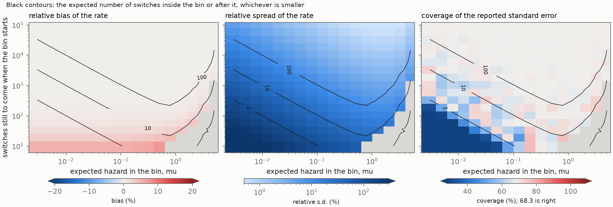

# M05. Rates from a switching histogram: bias, spread and the error bar

!!! note "Status"
    Draft: the claim below has not yet been approved by the maintainer.

**Claim (computed 2026-11-24, kramers 0.1.0).** A one-sigma error bar should cover the true rate 68.3% of the time. The one kramers reports with each bin's rate covers it 58.6% to 76.1% of the time wherever at least 10 switches are expected both inside the bin and after it, and 62.6% to 73.2% from 30; for bins where fewer than one switch is expected the coverage falls as low as 3%, because such a bin often reports a rate of zero with an error bar of zero. The estimate itself is biased by less than 5% where at least 10 switches are expected inside and after the bin (by up to 7.8% at 5), and by less than 1% from 50. These numbers come from a dense scan (every N from 10 to 400, 31 more to 20,000, 200 values of mu), not only the plotted grid; between scan points values can lie slightly outside them.



## What is compared

- **Approximation:** the Fulton-Dunkleberger estimate of the rate in one bin (K0025) and the delta-method standard error that kramers reports with it (an addition, not in the source).
- **Exact side:** the exact distribution of the estimate: given N switches still to come when the ramp enters the bin, the survivors past it are binomial with probability exp(-mu), mu the expected hazard in the bin; sums over that distribution, conditioned on at least one survivor.
- **Stored values:** relative bias and relative spread of the estimated rate, and the probability that the reported standard error covers the true rate (68.3% if it were a Gaussian one-sigma interval), over N and mu.
- **Entries:** [K0025](../handbook/K0025.md).

## Notes

Counting statistics of a single bin only. Not included: the error from assigning the rate to the bin centre (second order in the bin width, K0025), correlations between bins (they share survivors), and anything beyond a rate process under a ramp. As K0025 requires, every ramp is assumed to switch inside the histogram. Cells where no survivor is left with probability above 0.1% are not mapped; there the estimate is often undefined.

## Earlier work

- T. A. Fulton and L. N. Dunkleberger, Lifetime of the zero-voltage state in Josephson tunnel junctions, Phys. Rev. B 9, 4760 (1974). [doi:10.1103/PhysRevB.9.4760](https://doi.org/10.1103/PhysRevB.9.4760) Read: not opened (closed access); the origin of the estimator, as cited by K0025's source.

## Data and how to reproduce it

```python
from kramers import atlas
m = atlas.get("M05")
data = m.load()   # axes, series (None where not mapped), facts
print(m.claim())
```

Recompute: `python tools/build_atlas.py M05` (writes `src/kramers/data/atlas_M05.json` and this figure).

## How it is checked

| Check | Against | Latest result |
|---|---|---|
| the claim follows from the stored data | the stored grid | pass: worst 0.0e+00 (tolerance 0e+00), 2026-11-24 |
| the stored map is current (slow, nightly) | the same computation, at sample points | pass: worst 0.0e+00 (tolerance 1e-06), 2026-11-24 |
